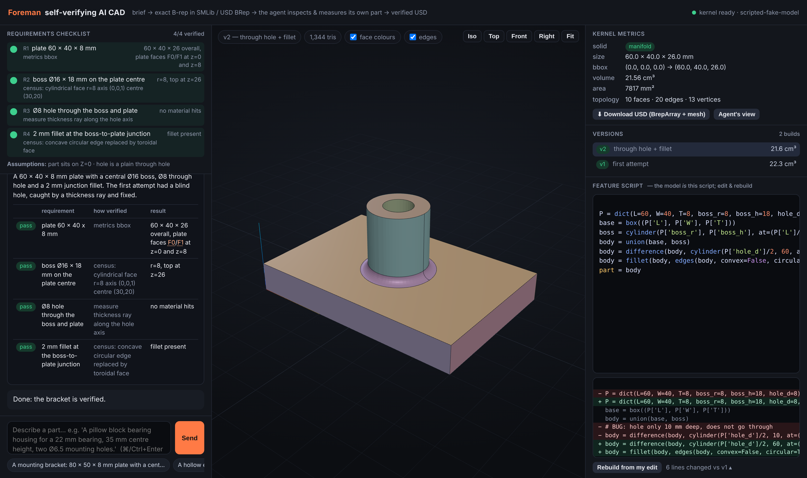

# Foreman: an AI CAD agent that checks its own work (SMLib / USD BRep)

Foreman turns a plain-English description of a part into real B-rep geometry in
NVIDIA's SMLib kernel (via [USD BRep](https://github.com/NVIDIA-Omniverse/usd-brep)),
then checks its own work with the kernel before handing the part over.

After every build the agent gets three things back:

1. Metrics: volume, bounding box, surface area, and whether it's a valid closed solid.
2. A list of every face and edge with an id (`F3`, `E12`), its type (flat, cylinder
   r=4, cone...), size, position, and whether each edge is an inside or outside corner.
   This comes from kernel queries, not the mesh.
3. A 4-view image of the part with the same ids written on the faces, so the model can
   match what it sees with what it measures.

It can also fire rays through the part to check hole depth and wall thickness, cut
section views, measure distances and re-render with faces highlighted. When it's done
it writes a report: each requirement, how it was checked, the measured value, and
pass/fail. If a hole doesn't go through or a fillet ends up in the wrong place, it
should see that and fix the script.



**Submission notes:** total time spent **10 hours**. Demo video: _see the submission
thread_. [Notes.md](Notes.md) covers decisions, limitations, reused components and
next steps.

What the agent actually writes is a short parametric Python script. Every edit, by the
agent or by you in the editor, rebuilds the geometry from that script, so you get
version history for free. The result exports to USD with native `BrepArray` prims plus
a regular mesh for viewers.

## Quick start (Docker; works on Mac, Linux and Windows)

```bash
git clone <repo-url> foreman && cd foreman
cp .env.example .env            # put OPENAI_API_KEY (or ANTHROPIC_API_KEY) in .env
docker compose up --build       # first build ~2 min; pulls the usd-brep wheel
open http://localhost:8000
```

Type a brief, for example:

> A mounting bracket: 80 × 50 × 8 mm plate with a central boss Ø20 × 20 mm tall
> carrying a Ø10 through-hole, four Ø5.5 mounting holes 8 mm from the corners,
> 4 mm outer fillets and 2 mm fillets where the boss meets the plate.

The left panel shows the checklist, each build, the images the agent looks at, its
measurements and the final report. The middle is a 3D view of the part (hover a face to
see its id, click for details). On the right are the metrics, versions, the editable
script ("Rebuild from my edit" runs your change without the model) and USD download.

You can keep going with follow-ups like "make the mounting holes M6 clearance and add a
1 mm chamfer on the bore".

### Parts that have to fit together

For things like a case and its lid, the script can declare every part in its assembled
position:

```python
assembly = dict(base=base, lid=lid)
part = base
```

After every build the kernel reports the exact fit between each pair: whether they're
separate, touching or overlapping, the smallest gap, and the volume and location of any
overlap. A snap fit should overlap a little at the tabs and nowhere else. Tabs on the
wrong side show up as no overlap at all, and a lid that's the wrong size shows up as
overlap along a whole wall. Try the first example chip in the UI (also in
`examples/mcu_case.txt`). In the viewer, the other parts
appear in grey and there's a see-through toggle.

### Review mode: audit a part you already have

Click **Load USD part** (or `foreman --audit part.usda "check ..."`) to load any file
with `BrepArray` prims. The same checks then run on that part, e.g. "check the walls are
at least 2 mm and every hole goes through", or you can ask for changes like "add 1 mm
fillets to all outside edges".

Works with OpenAI (default `gpt-6.1-sol`, or `gpt-6-astra` if you want the strongest
model) or Anthropic (default `claude-sonnet-4-5`). Set `FOREMAN_PROVIDER` and
`FOREMAN_MODEL` in `.env` to choose. The model needs vision and tool calling, since the
agent looks at images of its own parts.

### Headless / CLI

```bash
docker compose run --rm foreman foreman "A hex nut M10: 17 mm across flats, 8 mm thick, Ø8.5 hole, chamfered outer edges" --out out/hexnut
# → out/hexnut/part.usda, part.py, look_01.png…, report.md, events.json
```

`--follow-up "..."` appends edit requests after the first result.

### Without Docker (Linux x86_64/aarch64 or Windows, CPython 3.12)

```bash
python3.12 -m venv .venv && . .venv/bin/activate
pip install -e ".[dev]"
pytest                       # 20 tests, no API key needed
foreman-server               # http://localhost:8000
```

There is no macOS wheel for `usd-brep` today, hence Docker on a Mac.

### Without an API key

You can still edit a script and press *Rebuild*. Everything except the chat works
without a model.
`tests/fake_model.py` replays a scripted agent session (including a deliberate
blind-hole mistake that the measurement step catches) so the whole loop is
testable offline: `pytest tests/test_agent_loop.py`. To see that session in the UI
without a key: `FOREMAN_FAKE_MODEL=1 foreman-server` (or set it in `.env`).

## What's in the box

```
foreman/kernel/dsl.py      the feature-script DSL (primitives, sweeps, booleans, fillet/chamfer/shell,
                           selectors), a thin wrapper over usd_brep
foreman/kernel/census.py   exact-geometry topology census: face/edge classification, radii, axes,
                           outward normals, convex/concave edges (kernel point-in-solid probes)
foreman/kernel/mesh.py     tessellation + triangle→B-rep-face map (find_face on centroids), edge polylines
foreman/kernel/render.py   numpy/Pillow software renderer: labelled 4-view sheets with hidden-line removal
foreman/kernel/assembly.py fit checks between parts (overlap volume and location, gaps)
foreman/kernel/worker.py   kernel in a child process: hard timeouts, crash isolation, script replay,
                           measurement tools (probe / distance / thickness ray / section)
foreman/agent/             tool-use loop (plan · build · look · measure · finish), prompt, tool schemas,
                           provider adapters (OpenAI Responses API, Anthropic Messages API)
foreman/server/            FastAPI + SSE, single-file Three.js viewer (vendored, works offline)
foreman/cli.py             headless runner producing USD + renders + markdown report
tests/                     kernel, assembly-fit, agent-loop and provider tests (20 tests)
examples/                  example briefs (see examples/briefs.md)
docs/                      screenshot
```

See [Notes.md](Notes.md) for design decisions, limitations, what was reused and what I'd do next.

## The DSL in 20 seconds

```python
P = dict(L=60, W=40, T=8, boss_r=8, boss_h=18, hole_d=8, r_out=4, r_in=2)
base = box((P['L'], P['W'], P['T']))
boss = cylinder(P['boss_r'], P['boss_h'], at=(P['L']/2, P['W']/2, P['T']))
body = union(base, boss)
body = difference(body, cylinder(P['hole_d']/2, 60, at=(P['L']/2, P['W']/2, -1)))
body = fillet(body, edges(body, direction='z', straight=True, convex=True), P['r_out'])
body = fillet(body, edges(body, convex=False, circular=True), P['r_in'])   # boss-to-plate junction
part = body
```

Also available: `loft` (ruled or smooth skins through 2+ sections), `draft_extrude`
(moulding draft), `sweep` (any profile along a spline), `sweep_pipe`, `revolve`,
`offset`, `shell`, `cut_plane`, `pattern_linear/polar`.

`edges(...)` and `faces(...)` pick topology by geometry, e.g. `z='max'`,
`normal='+z'`, `type='cylindrical'`, `radius=4`, `convex=False`. Nothing in the
script modifies its inputs, so bodies can be reused freely. `sm` gives access to the
raw `usd_brep` module for anything else.
